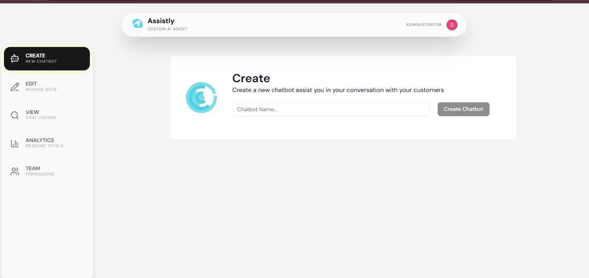
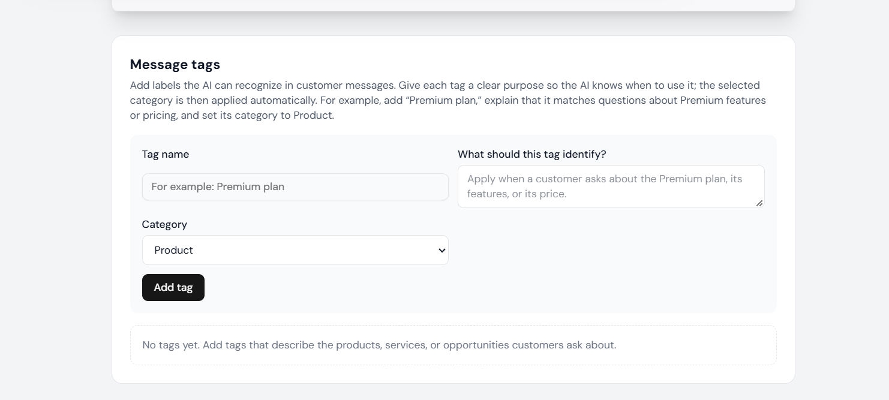
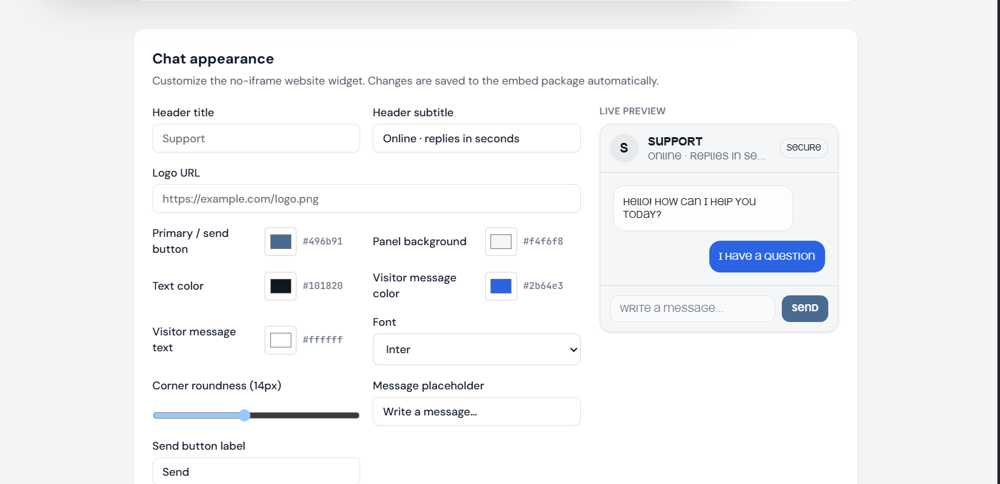
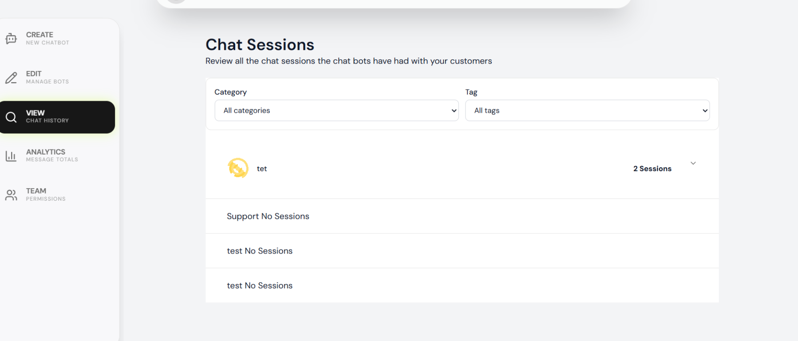
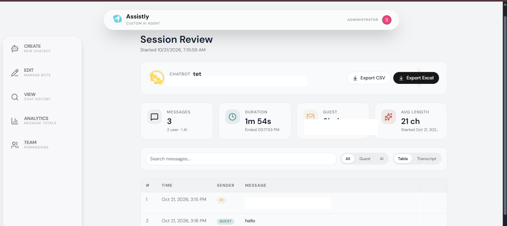
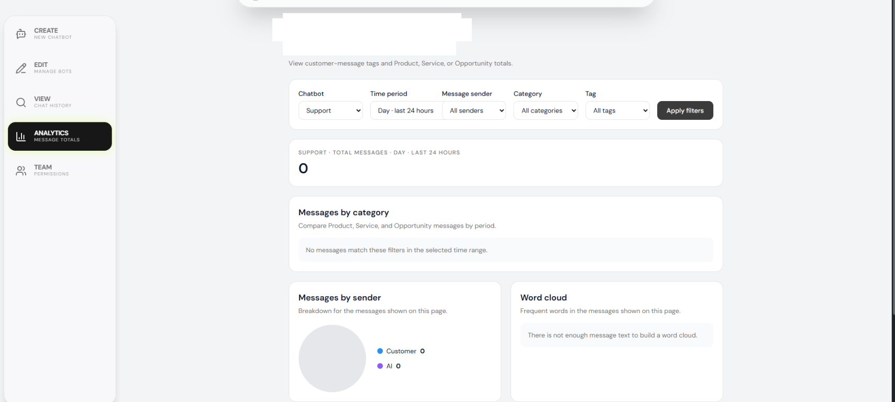
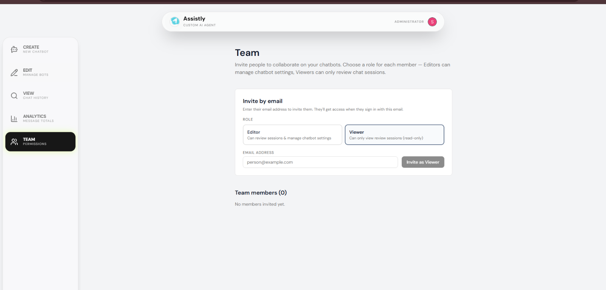

# Assistly

Assistly is a multi-tenant AI chatbot SaaS that lets authenticated teams create, customize, and embed business-specific chatbots. It combines an admin dashboard, public and embeddable chat experiences, conversation analytics, configurable message tags, and tenant-scoped data management so each organization can operate its own chatbot knowledge and workflows.

## Main features

- Clerk-authenticated admin dashboard and tenant ownership
- Custom chatbot names, knowledge characteristics, widget appearance, and message tags
- Hosted guest chat pages and a reusable embeddable React widget
- Conversation history, analytics, filtering, and enquiry classification
- Neon Postgres persistence with parameterized SQL
- Groq-powered responses grounded in each chatbot's configured knowledge
- Cross-origin embedding support for customer websites

## Stack

- **Frontend:** Next.js 16 App Router, React 19, TypeScript, Tailwind CSS
- **UI:** Radix UI and shadcn-style components
- **Authentication:** Clerk
- **Database:** Neon Postgres and the Neon serverless driver
- **AI:** Groq Chat Completions through `lib/groqPool.ts`
- **Embed:** React package in `packages/embed`, built with tsup
- **Package manager:** pnpm

## Architecture

Admin users and invited collaborators are identified by Clerk. Database queries scope chatbot records by the authenticated Clerk user or by an authorized invited email, keeping tenant records separated in application queries. A public chatbot page loads only the requested chatbot; chat sessions and messages remain associated with that chatbot.

When a visitor sends a message, the server loads the chatbot's configured characteristics and recent conversation history, adds them to the model prompt, and calls Groq for a response. The model answers from the saved characteristics rather than crawling linked websites. Admin-configured message tags are also applied to classify customer enquiries.

## Setup

### Requirements

- Node.js
- pnpm
- A Neon Postgres database
- Clerk credentials
- One or more Groq API keys

### Local setup

1. Install dependencies:
   ```bash
   pnpm install
   ```

2. Create `.env.local` and configure:
   ```dotenv
   DATABASE_URL=your_neon_postgres_connection_string
   NEXT_PUBLIC_CLERK_PUBLISHABLE_KEY=your_clerk_publishable_key
   CLERK_SECRET_KEY=your_clerk_secret_key
   GROQ_API_KEY=your_groq_api_key
   ```

   `GROQ_API_KEY_1` through `GROQ_API_KEY_20` may also be configured.

3. Apply the schema and migrations in `migrations/` to your Neon database.

4. Start the app:
   ```bash
   pnpm dev
   ```

   Open `http://localhost:3000`.

Production environment variables should be set in the hosting provider. Never commit `.env` files or credentials.

## Screenshots

### Create and configure a chatbot



### Message tags



### Widget appearance



### Chat history



### Session review



### Analytics



### Team permissions




## Commands

```bash
pnpm dev          # Start Next.js locally
pnpm build        # Build the embed package and application
pnpm start        # Serve the production build
pnpm lint         # Run lint
```
